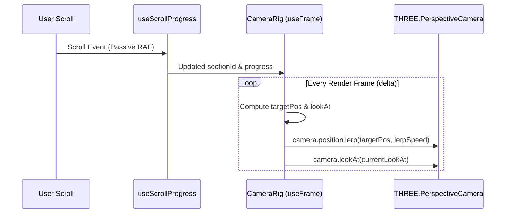

# ANIMATION SYSTEM — UNIVERSE WITHIN

## 1. Overview
The motion language of **UNIVERSE WITHIN** is designed around cinematic continuity: smooth, weightless transitions inspired by cinematic space documentaries and high-end creative development showcases.

---

## 2. Scroll-Driven Camera Synchronization
Rather than hijacking native scroll, the application calculates continuous scroll metrics through `src/hooks/useScrollProgress.ts`:

$$\text{progress} = \frac{\text{scrollY}}{\text{scrollHeight} - \text{innerHeight}}$$



### Camera Position Targets:
| Narrative Chapter | Target Position `[x, y, z]` | LookAt Vector `[x, y, z]` | Description |
| :--- | :--- | :--- | :--- |
| **01 Intro** | `[0, 45, 130]` | `[0, 0, 0]` | Wide establishing perspective |
| **02 Deep Space** | `[0, 120, 200]` | `[0, 10, -50]` | Elevated drift through stellar dust |
| **03 Solar System** | `[0, 55, 105]` | `[20, 0, 0]` | Angled orbital plane view |
| **04 Planet Observatory** | Focused on Planet | `[Planet.orbitRadius, 0, 0]` | High-detail close-up observation |
| **05 Earth Special** | `[40.5, 1.2, 5.5]` | `[36, 0, 0]` | Close study of oceans and Moon |
| **06 Beyond Planets** | `[0, 12, -125]` | `[0, 0, -160]` | Approach to Black Hole singularity |
| **07 Cosmic Scale** | `[0, 180, 260]` | `[0, 0, 0]` | High-altitude cosmic zoom |
| **08 Discoveries** | `[20, 40, 80]` | `[0, 0, 0]` | Angled observatory telemetry angle |
| **09 Final Vista** | `[0, 30, 90]` | `[0, 0, 0]` | Horizon return perspective |

---

## 3. Celestial Mechanics & Rotation Loops
Planets rotate dynamically in each frame using delta-time scaling:
```typescript
useFrame((_, delta) => {
  if (!reducedMotion) {
    planetRef.current.rotation.y += delta * rotationSpeed;
    orbitGroupRef.current.rotation.y += delta * orbitSpeed;
  }
});
```
- Retrograde rotation (Venus and Uranus) is faithfully supported via negative rotational multipliers.
- Tidally locked simulation for the Moon keeps its near side permanently facing Earth.

---

## 4. Reduced Motion Fallback
When the visitor activates Reduced Motion (or has `prefers-reduced-motion` enabled in their operating system):
1. Ambient scene rotations and orbital velocities are halted.
2. Camera interpolation speeds are tightened to eliminate disorienting camera sweeps.
3. All educational data remains fully accessible and legible.
