# UNIVERSE WITHIN — A Journey Beyond the Visible

**Explore the infinite. Discover the unknown.**

An immersive, scroll-driven 3D astronomy experience: twelve cinematic chapters from Earth to the cosmic web, plus a six-tool interactive Cosmic Lab. Built with React, Three.js, React Three Fiber, custom GLSL shaders, GSAP ScrollTrigger and Lenis.

**Live site:** https://ver-dev9.github.io/Universe-Within/

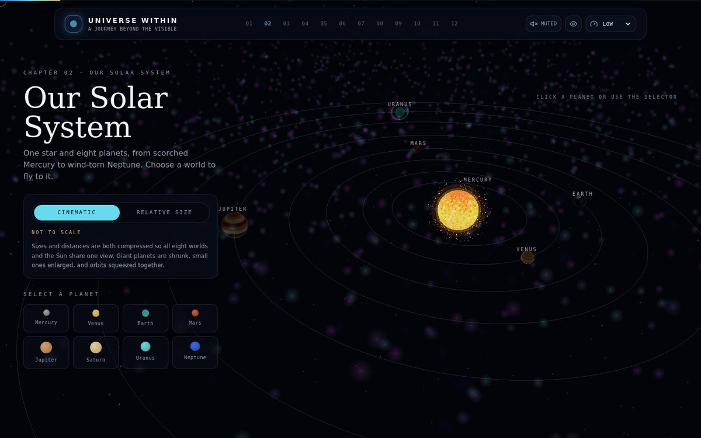

> Screenshots in this README are real captures of the production build, taken in headless Chromium with software WebGL (SwiftShader). That forces the **LOW** quality tier and fallback fonts, so a GPU browser on MEDIUM/HIGH looks sharper and brighter.

---

## Vision

Universe Within is a creative-development and science-communication portfolio project. The goal is to pair the feel of a space documentary with real interactivity, without sacrificing accuracy. Every astronomical figure in the experience comes from NASA, ESA, ESO, the NASA Exoplanet Archive or peer-reviewed papers, with its source linked on the page and in `src/data/`. Estimates are marked with ≈, and artistic visualizations are labelled as such.

## The twelve chapters

| # | Chapter | What you can do |
|---|---------|-----------------|
| 01 | **The Beginning** | Cinematic opening over a procedural Earth |
| 02 | **Our Solar System** | Orbiting system with fly-to planet selection; switch between *cinematic* and *relative size* modes. Planet deep-dives and an Earth chapter follow |
| 03 | **The Power of the Sun** | Shader-driven photosphere, corona and solar-wind particles; core temperature, luminosity and structure facts |
| 04 | **Worlds Beyond Earth** | Tabbed exploration of rocky worlds, dwarf planets, asteroids and comets with procedural surfaces |
| 05 | **The Moons** | Europa, Io, Titan, Enceladus and more, each with ocean, volcanism or atmosphere notes |
| 06 | **The Life and Death of Stars** | Scroll-pinned stellar life cycle by mass, from nebula to white dwarf, neutron star or black hole, plus where the elements come from |
| 07 | **Nebulae** | Volumetric fly-throughs of the Orion, Eagle and other nebulae |
| 08 | **Black Holes** | Real-time ray-marched black hole with an accretion disk, photon ring and Doppler beaming; event horizon, photon sphere, ISCO, Sgr A* and M87* |
| 09 | **Galaxies Beyond Imagination** | Procedural particle galaxies: barred-spiral Milky Way, Andromeda, M87 elliptical, LMC-type irregular and the interacting Antennae |
| 10 | **The Search for Other Worlds** | Transit lab whose light-curve dip follows depth ≈ (Rp/R★)²; a radial-velocity explainer; TRAPPIST-1, Proxima b, Kepler-186f, 51 Peg b and WASP-39b. Confirmed exoplanets: **6,473**, from the NASA Exoplanet Archive as of 19 Nov 2026 |
| 11 | **The Architecture of the Universe** | Scroll zoom through a procedural cosmic web: Local Group, Virgo Supercluster, Laniakea, then the observable universe; Planck matter and energy budget |
| 12 | **Beyond the Visible** | Finale and full scientific references |

| | | |
|---|---|---|
| 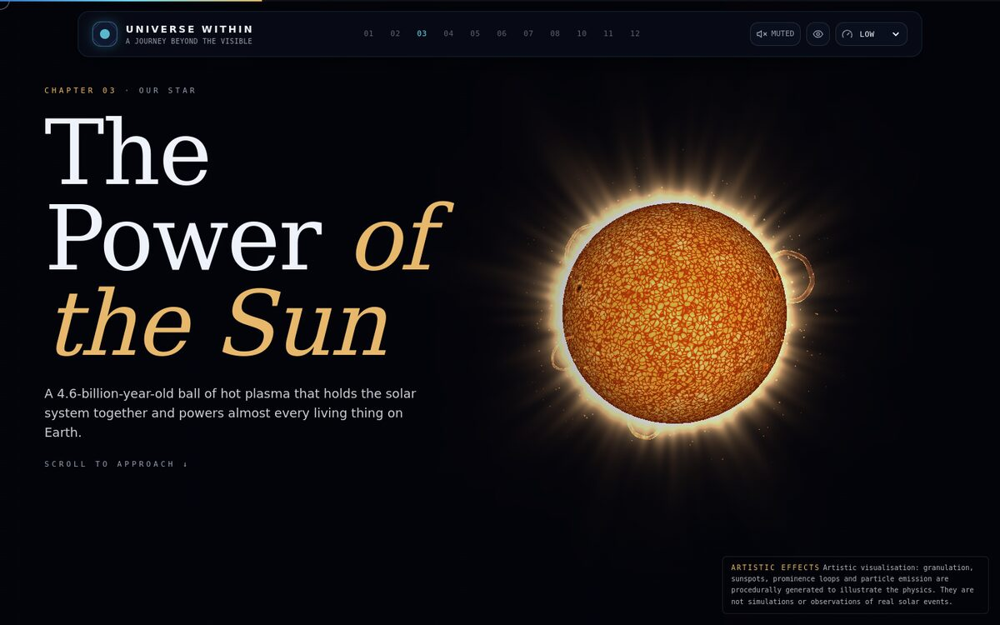 | 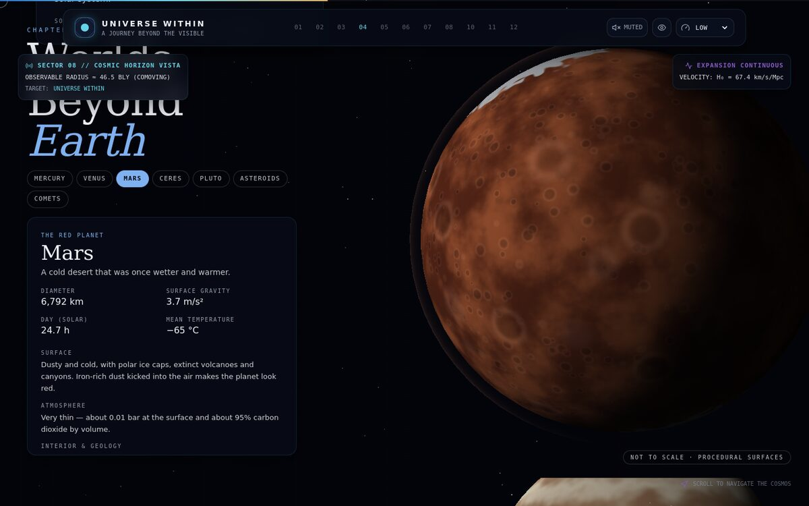 | 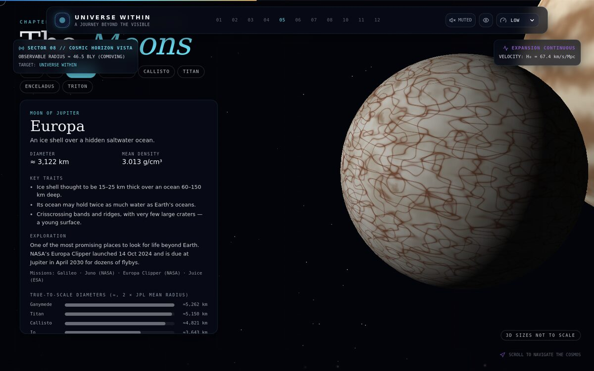 |
| 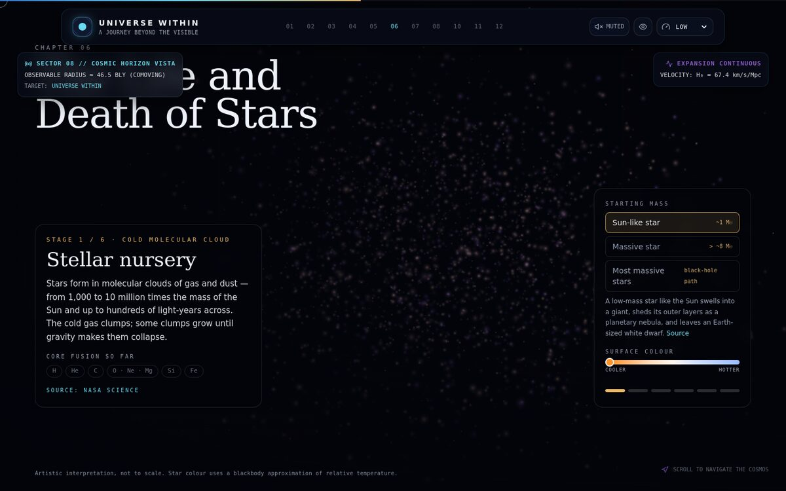 | 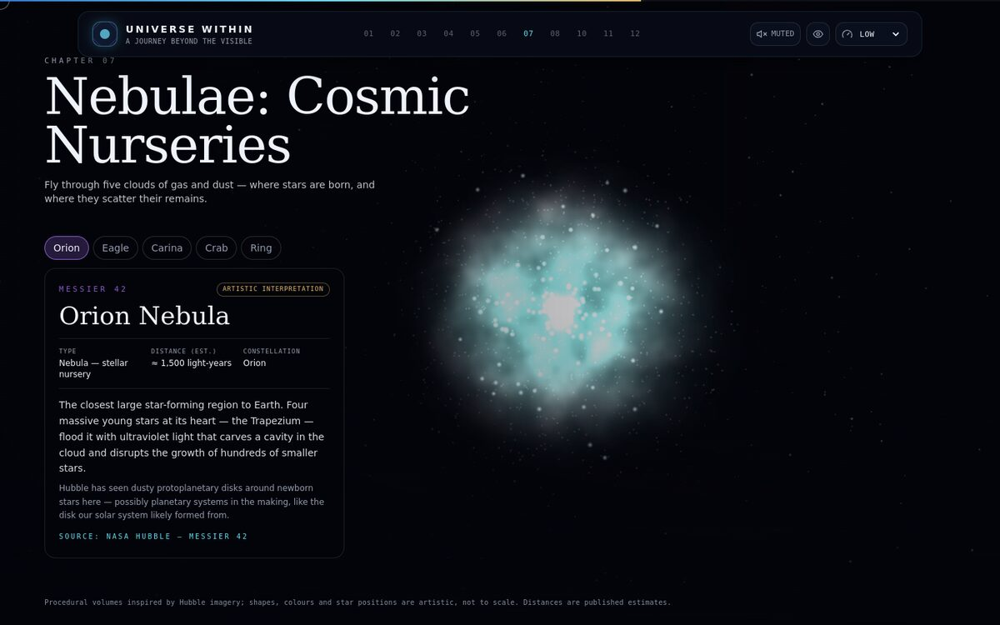 | 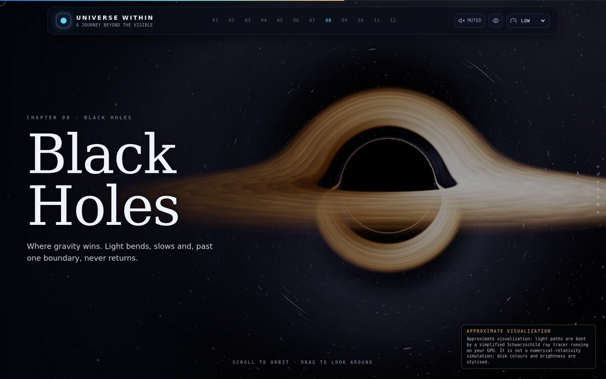 |
| 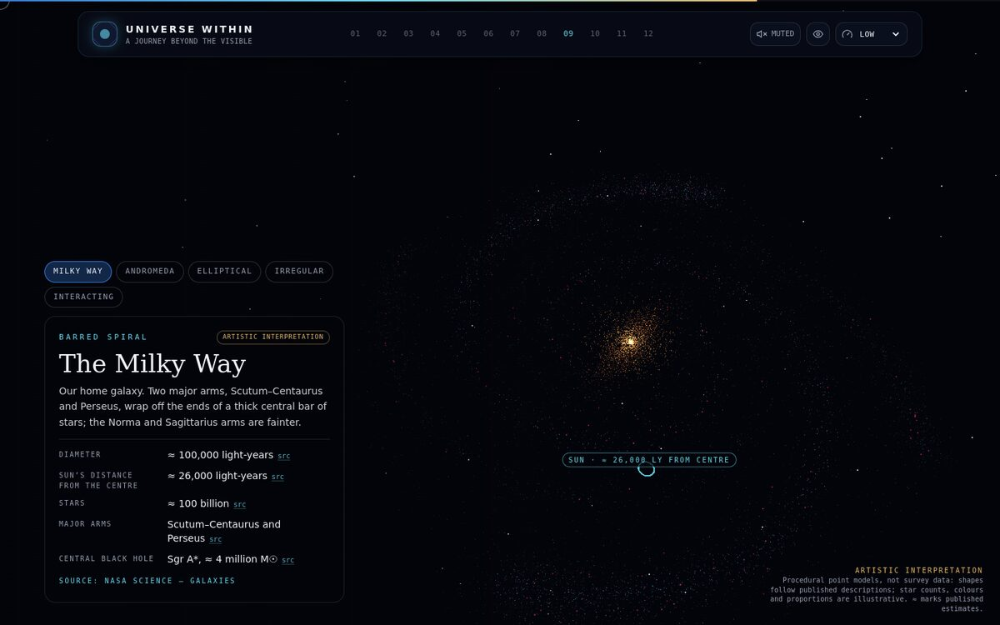 | 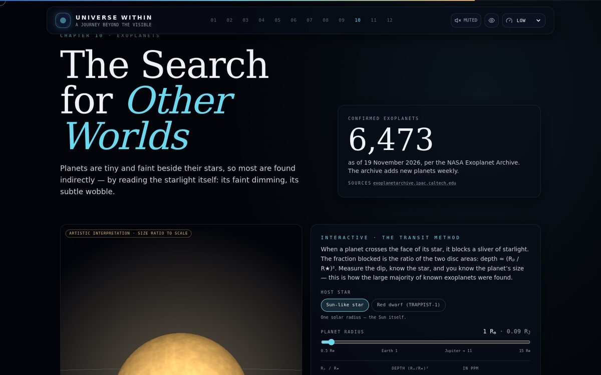 | 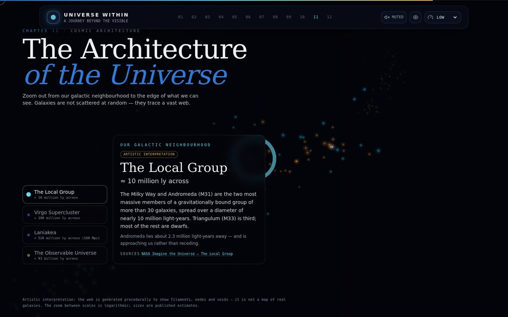 |

## Cosmic Lab

A dedicated interactive laboratory (section `#cosmic-lab`). Each tool has real controls that drive the visualization, live readouts, a Reset button, an explanation and source links. Only one WebGL canvas is mounted at a time, and each tool is lazy-loaded.

1. **Planet Explorer**: rotate and inspect planets; axial tilt and day length.
2. **Solar System Explorer**: orbits under Kepler's third law (live P²/a³ ≈ 1), time speed, planet toggles.
3. **Planetary Scale Comparison**: true relative sizes.
4. **Stellar Explorer**: temperature drives blackbody colour; Wien peak; luminosity via Stefan–Boltzmann (L ∝ R²T⁴); Sun, Proxima Centauri, Sirius A/B, Betelgeuse and Rigel presets.
5. **Black Hole Explorer**: mass slider with the Schwarzschild radius r_s = 2GM/c² computed live; inclination, disk temperature, brightness and lensing strength. Labelled an educational approximation.
6. **Cosmic Distance Explorer**: log-scale zoom from the Earth–Moon distance to the observable universe, with light-travel time.

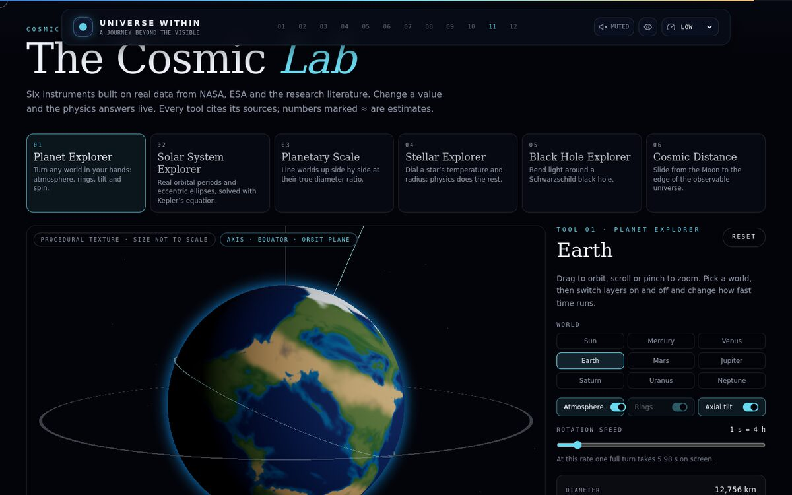

## Technology stack

- **React 18 + TypeScript 5**, built with **Vite 5**
- **Three.js r160**, **@react-three/fiber 8**, **@react-three/drei 9**, **@react-three/postprocessing**
- **Custom GLSL**: photosphere, stellar surfaces, nebula volumes, black-hole ray-marcher, world surfaces, particle systems
- **GSAP 3 ScrollTrigger + Lenis** for smooth, scroll-driven per-chapter timelines, cleaned up on unmount
- **Zustand** for global state (quality tier, audio, reduced motion); **Tailwind CSS 3** design tokens
- **GitHub Actions → GitHub Pages** for deployment from `main`

## Architecture

```
src/
  App.tsx                      chapter order
  components/
    sections/                  v1-derived sections (intro, solar system, planets, Earth, finale)
    sections/chapters/         v2 chapters 03–11 (+ shared ChapterCanvas, SourceList, useInView)
    navigation/, layout/       chapter rail, navbar, progress bar
  lab/                         Cosmic Lab and its six tools (lazy-loaded)
  scenes/                      R3F scenes per chapter (sun, nebulae, black-holes, galaxies, exoplanets, cosmicweb…)
  shaders/                     GLSL as TS modules
  data/                        sourced astronomical data, with a URL for every figure
  store/, hooks/               zustand store, quality, reduced-motion, scroll hooks
docs/screenshots/              real captures used in this README
```

Each chapter mounts its own canvas only near the viewport (IntersectionObserver), reads the quality tier, and disposes geometry, materials and ScrollTriggers when it unmounts.

## Quality, accessibility and motion

- **Quality tiers** LOW / MEDIUM / HIGH, picked automatically and switchable in the navbar. They scale particle counts, ray-march steps and post-processing.
- **Reduced motion**: honours `prefers-reduced-motion` with static layouts and no auto-animation.
- **Sound is muted by default.**
- Keyboard-navigable tabs (arrows, Home/End), labelled sliders, visible focus and screen-reader descriptions of the 3D scenes.

## Getting started

```bash
git clone https://github.com/ver-dev9/Universe-Within.git
cd Universe-Within
npm install
npm run dev        # http://localhost:5173
npm run build      # type-check + production build into dist/
npm run preview    # serve the production build
```

Pushing to `main` runs `.github/workflows/deploy.yml`, which builds and publishes to GitHub Pages.

## Scientific sources

Key references: NASA Planetary Fact Sheets and NASA Science, the NASA Exoplanet Archive, ESA (Planck, Gaia), ESO and the Event Horizon Telescope (Sgr A*, M87*), and Tully et al. 2014, *Nature* 513 (Laniakea). Every figure is cited next to its data in `src/data/*.ts` and on the page; see also [SCIENTIFIC_SOURCES.md](SCIENTIFIC_SOURCES.md).

## Known limitations

- Galaxies look dim on the LOW tier; MEDIUM/HIGH are recommended on desktop GPUs.
- 3D objects are procedural (shaders and particles) rather than GLB models.
- The black-hole and cosmic-web visualizations are educational approximations, not simulations.
- The mobile layout has not been fully tested yet; desktop is the primary target.

## Versions

- **v2.0.0**: the twelve-chapter cinematic rebuild and the Cosmic Lab.
- **v1.0.0**: the original site, preserved as a tag.

## License

MIT. See [LICENSE](LICENSE).
