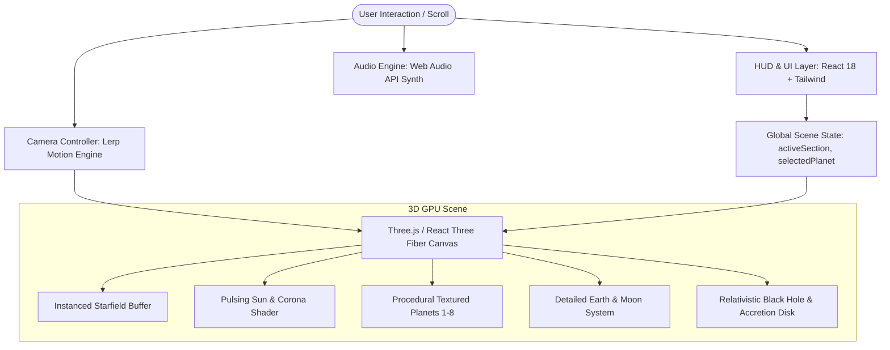

# TECHNICAL ARCHITECTURE — UNIVERSE WITHIN

## 1. System Overview
**UNIVERSE WITHIN** is built on a decoupled, modular frontend architecture designed to guarantee 60 FPS rendering while orchestrating complex 3D scenes, real-time audio synthesis, and interactive scientific data exploration.



---

## 2. Rendering Pipeline
- **Single Canvas Singleton:** A single persistent `<Canvas>` element handles all 9 narrative chapters. Rather than creating and unmounting multiple heavy WebGL contexts (which causes memory leaks, context-loss crashes, and stutter), all celestial objects exist in a unified continuous 3D world coordinate system.
- **Coordinate System Mapping:**
  - `[0, 0, 0]`: Central Star (Sol) and the orbital plane of the Solar System.
  - Radial distance $r \in [18, 104]$: Orbits of Mercury through Neptune.
  - Coordinates `[36, 0, 0]`: Earth-Moon system.
  - Coordinates `[0, 0, -160]`: The relativistic deep space sector featuring the Supermassive Black Hole and accretion disk.
- **Procedural Canvas Texture Synthesizers:**
  To guarantee instant load times and eliminate HTTP image asset bottlenecks, textures are procedurally baked onto HTML5 off-screen canvases via `src/utils/textureGenerators.ts`:
  - 1024x512 equirectangular maps for all 8 planets.
  - Multi-tiered radial alpha map for Saturn's rings.
  - Nightside bioluminescent city illumination map for Earth.

---

## 3. Shader Implementations
### A. Rayleigh Atmospheric Fresnel Shader (`atmosphereShader.ts`)
Calculates viewing angle relative to surface normals:
```glsl
vec3 viewDir = normalize(-vPosition);
float fresnel = 1.0 - max(dot(viewDir, vNormal), 0.0);
fresnel = pow(fresnel, uPower);
gl_FragColor = vec4(uColor, fresnel * uIntensity);
```
Applied to Earth, Venus, Mars, and Gas Giants with wavelength-specific atmospheric hues.

### B. Relativistic Accretion Disk Shader (`blackHoleShader.ts`)
Simulates Doppler beaming and differential rotation:
```glsl
float rotSpeed = 1.8 / pow(max(dist, 0.1), 1.2);
float spiral = angle + uTime * rotSpeed;
float dopplerFactor = -d.x * 1.5;
float intensity = (0.7 + dopplerFactor * 0.5) * iscoPeak * radialFade;
```

---

## 4. Audio Architecture (`useAudioEngine.ts`)
Synthesized on-the-fly using the Web Audio API without requiring any audio media files:
- **Sub-Bass Drone:** Sawtooth oscillator at 55 Hz (A1) detuned against a secondary sine oscillator at 55.6 Hz to generate subtle 0.6 Hz binaural acoustic beating.
- **Resonant Lowpass Filter:** BiquadFilterNode at 280 Hz with Q factor 4.0 modulated by an ultra-slow 0.08 Hz LFO.
- **User Privacy & Autoplay Policy:** Begins muted; requires explicit user interaction to unmute.
